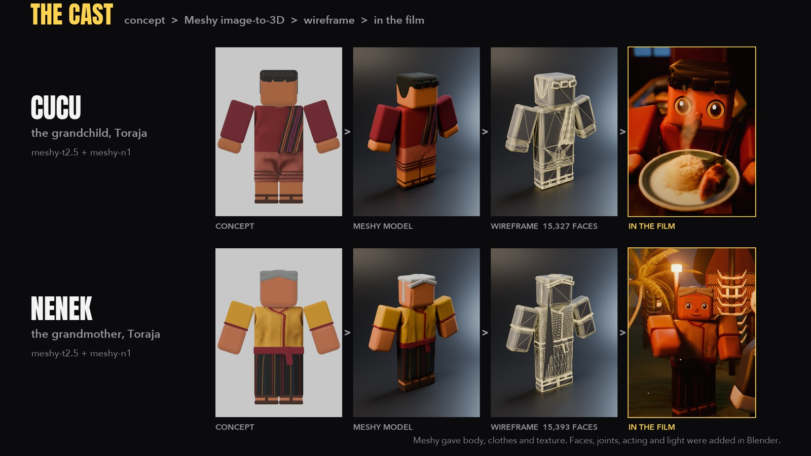
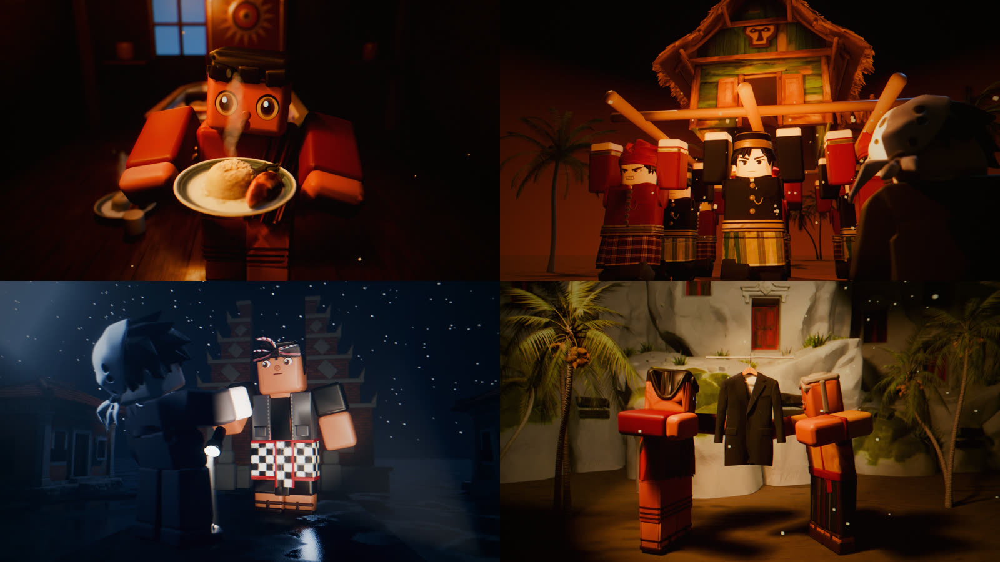
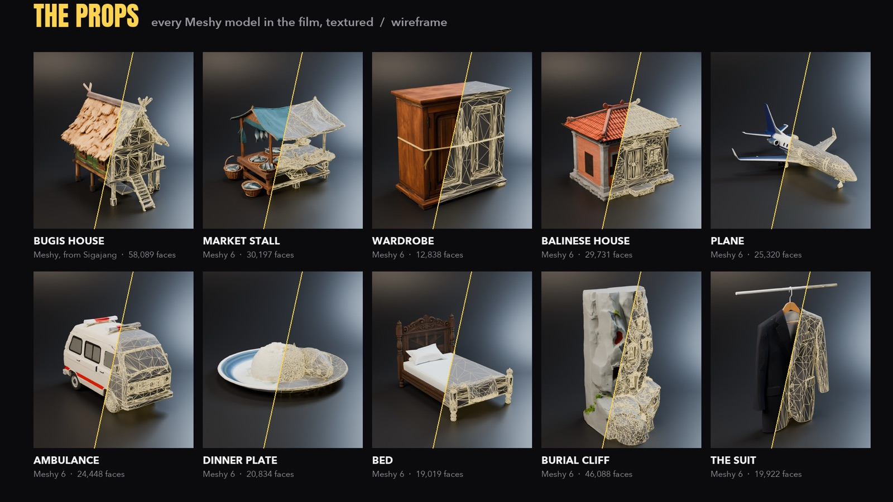
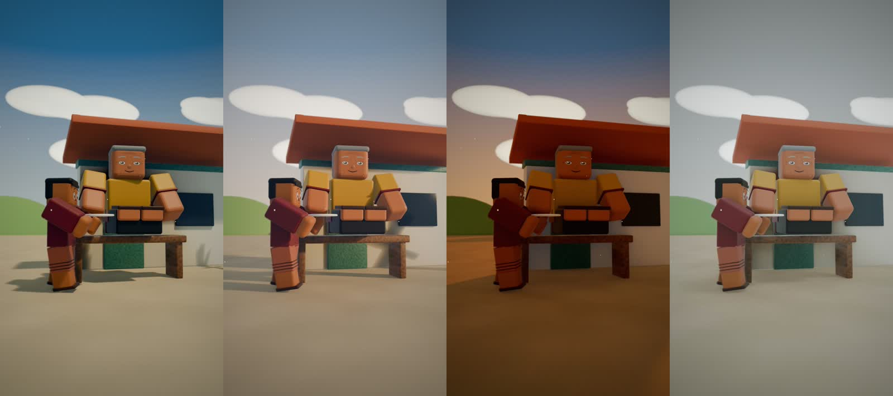
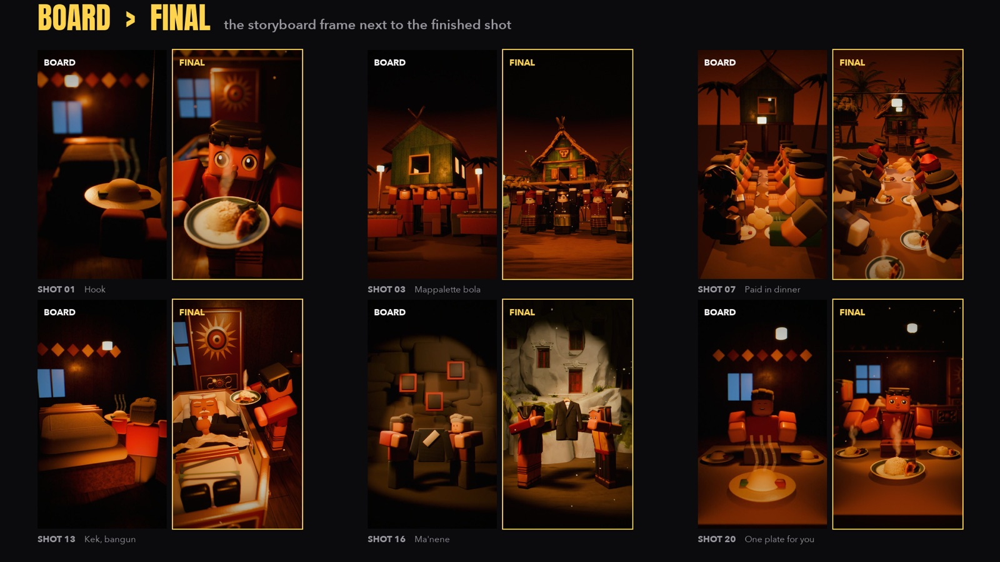
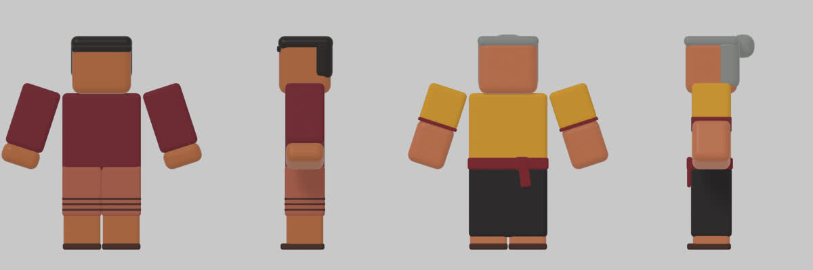
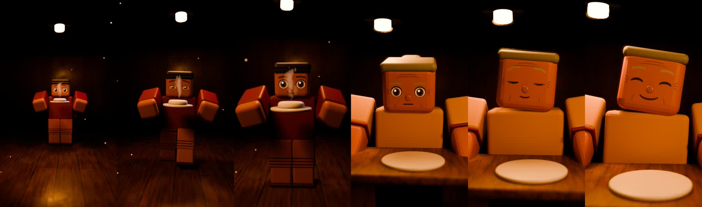

# robloxanimax

A Claude Code skill that turns **a script and a voice-over into a narrated, Roblox-style animated short**, with a cast and props
generated by **Meshy through its MCP server** and everything after that (rigging, faces, acting, light, cut, sound and captions) done in Blender.



*Tiga Tradisi ("In This Town: Nggak Ada yang Sendiri"): a 79-second vertical film about three Indonesian traditions (Bugis
mappalette bola, Balinese Nyepi, Torajan ma'nene). Four characters came from Meshy image-to-3D for 15 credits each. Blender added
their joints, their faces, their acting and the light. This skill is that film's pipeline, made reusable.*



## What it does

- **Designs a cast Meshy can build.** Describe each character's outfit in `project.json`. [block_ref](blender/block_ref.py) renders
  it on a blocky toy body, **with no face**, from the front, side and back. That front view is what you send to Meshy. You can also
  lay pixels from an approved concept image (a woven cloth, a batik) onto the clothes so they carry into the texture.
- **Generates the cast through the Meshy MCP.** Characters go through image-to-3D with `meshy-t2.5` smart topology and the
  `meshy-n1` texture: 15 credits a character, about 15,000 faces, and every block comes back as a separate part. The
  [Meshy guide](references/meshy.md) has the exact tool calls, prompts and prices. It also covers the two rules that protect your
  credits: confirm the price before every call, and never re-create a task that might already exist.
- **Plans, generates and checks the props.** Every prop the story needs goes into one list with its size in the film and a route:
  - `text`: Meshy 6 text-to-3D, 30 credits.
  - `draft`: a cheaper Meshy 6 Lite version for background props, 15 credits.
  - `image`: an approved design image turned into 3D, for anything that must look like one specific thing.
  - `multi`: a model you already have, copied from 2-4 views.
  - `reuse`: a model from an earlier film.
  - `kit`: built by hand in Blender.

  Shots use free stand-in boxes until each model exists. [props_plan](scripts/props_plan.py) prints every prompt, every MCP call
  and the total credits, so you approve the cost once before anything is generated. When the models arrive,
  [prep_props](blender/prep_props.py) swaps them in, and the shots don't change. The [props workflow](references/props.md) covers
  the whole route, including what to do when Meshy gets a cultural building wrong.
- **Rigs the model automatically.** Because the parts come back separate, [prep_cast](blender/prep_cast.py) can sort them into
  head, body, arms and legs, cut the joints and set the pivots. A sarong or skirt stays one swinging block. No Meshy rigging and
  no hand weighting are needed.
- **Gives every character a live face.** The [runtime](blender/anima.py) adds eyes with irises and highlights, eyelids that blink,
  eyebrows, a nose and ten mouth shapes to the blank head. The faces lip-sync to the real voice and switch between 15 expressions.
  Older characters get wrinkles, and one setting gives a character winged lashes.
- **Times the film to the voice.** [voice.py](scripts/voice.py) cuts every spoken line out of the real recordings without changing
  their speed or pitch. It places each line in its shot and rounds every shot up to the nearest half beat of the music. The result
  is a timeline that gives every shot, line and word a frame number. Shots then act on the words themselves:
  `word('13', 'bangun')`.
- **Builds one scene per shot.** Each shot is a short Python function. [render.py](blender/render.py) uses lock files to share the
  work between two workers, can resume after a stop, and makes stills or quarter-size previews before the real render.
- **Lights any mood.** One `mood()` call lights an exterior: bright `day`, fresh `morning`, warm `golden` hour, soft
  `overcast`, or Tiga Tradisi's `dusk`, `night` and `dawn`. Each daylight mood comes with its own grade and its own look-gate
  band, plus drifting clouds and plants that move in the breeze. The low-key, lamp-lit look stays available, and one film can
  change mood from scene to scene. See [moods](references/moods.md).
- **Checks the work.** A [clip scan](blender/clip_check.py) finds characters passing through each other or through props.
  The look gate measures brightness, shadows, highlights and saturation against the band for each shot's mood. Loudness, frame count and caption timing are
  checked before you post.
- **Finishes the reel.** The final steps grade each location in its own look (a daylight grade or a low-key one), mix the music under the voice with planned silences
  and timed sound effects at -14 LUFS, and burn in captions with the spoken word in gold. They export the main reel, an English
  version, a labels-only version and a version without the voice.
- **Shows how it was made.** [studio.py](blender/studio.py) renders each Meshy model untouched, textured and as a wireframe.
  [cast_card.py](scripts/cast_card.py) makes the **THE CAST** pages above, [props_card.py](scripts/props_card.py) makes the
  **THE PROPS** pages below, and [pairs.py](scripts/pairs.py) puts each untouched model next to the film frame where it appears. The [ledger](scripts/ledger.py) records every Meshy task,
  its credits and whether the model made the final cut. That is the record a contest entry or a sponsor asks for.







## The workflow

```
script ─▶ board ─▶ faceless block refs ─▶ free stand-ins ─▶ blocked film (stills, look gate)
              │           │
              │           └─▶ Meshy MCP image-to-3D ─▶ prep_cast (auto-rig) ─▶ same shots, real cast
              └─▶ props list ─▶ stand-in boxes ─▶ props_plan (prompts + price, your OK) ─▶ Meshy MCP ─▶ prep_props ─▶ real props
voice takes ─▶ phrases ─▶ timeline (half-beat grid) ─▶ acting on the words ─▶ clip scan
                ─▶ preview cut (¼ size, minutes) ─▶ your OK ─▶ final render (2 workers) ─▶ mix ─▶ captions ─▶ reels + cast and props cards
```

Every stage ends on something you can look at, and each one has a gate (see [workflow](references/workflow.md)). Meshy credits
and long renders always wait for your OK. [Lessons](references/lessons.md) lists what each film taught. Examples include the chin
seam, the props Meshy got wrong for one culture, voice timing at pauses, and EEVEE shadow flicker.

## Install

Requirements:

- [cinematicanimation](https://github.com/aaksa/cinematicanimation), which provides the toolkit, finishing and look gate
- Blender 5.x
- Python 3
- ffmpeg
- the [Meshy MCP server](https://docs.meshy.ai/en/api/ai), only for generating new models

Tested on Blender 5.1.2 on an Apple M4.

```bash
git clone https://github.com/aaksa/robloxanimax.git
cd robloxanimax
bash install.sh                 # links it into ~/.claude/skills/robloxanimax and checks the requirements
```

## Try it without Meshy

The demo in `examples/demo` builds two characters as free stand-ins, rigs them, and renders a two-shot scene of a child carrying a steaming plate to
a grandmother who looks up and smiles indoors by lamplight. A third shot moves outside at midday in the `day` mood. It then mixes
and assembles the reel. No Meshy account is needed.



```bash
B=/Applications/Blender.app/Contents/MacOS/Blender
BP=/Applications/Blender.app/Contents/Resources/5.1/python/bin/python3.13
P=examples/demo                                                   # or: python3 -I scripts/new_project.py <folder>
"$B" -b --factory-startup -P blender/block_ref.py -- $P --glb     # references + stand-ins
"$B" -b --factory-startup -P blender/prep_cast.py -- $P           # auto-rig
"$BP" -I scripts/voice.py $P                                      # timeline (no voice yet: "beats" per shot)
"$B" -b --factory-startup -P blender/render.py -- $P --stills .1,.5,.95
PREVIEW=1 bash scripts/render.sh $P && "$BP" -I scripts/mix.py $P && bash scripts/assemble.sh $P
```



To use Meshy, send `ref/<name>_front.png` to `meshy_image_to_3d` with the settings in the [Meshy guide](references/meshy.md).
Save the result over `assets/raw/<name>.glb` and run `prep_cast.py` again. The shots stay the same, but the cast is now the real one.

## Using it from Claude Code

Ask for a Roblox animated film, a "Di kota ini / In this town" story film with Meshy characters, or run `/robloxanimax`. Claude
writes the script with your script skills, designs the cast and shows it to you. It quotes the Meshy cost, waits for your yes and
generates the models through the MCP. Then it builds the shots, sends stills and a preview cut, and renders the final film only
after you approve.

## Credits and limits

- The workflow comes from *Tiga Tradisi* (Nov 2026). That film's project, voice, music and Meshy models are not part of this
  repository; the README images are frames and work-in-progress pages from it.
- Cultural claims in a film are the filmmaker's responsibility. The skill records what has been checked and what has not, but it
  cannot check them for you.
- Roblox is a trademark of Roblox Corporation, and Meshy is a product of Meshy AI. This project is not affiliated with either.
- Characters are original. Do not recreate characters or sets from another creator's films.

MIT licence.
