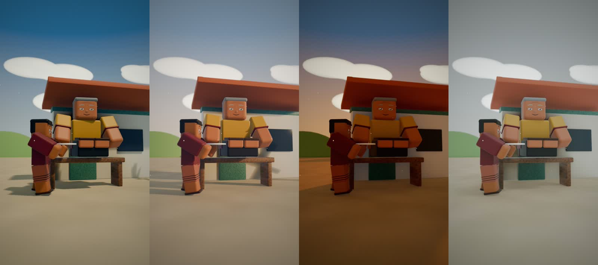

# Moods: daylight as well as the dark

Tiga Tradisi lived at dusk, at night and by lamplight, the cinematicanimation look. A story set in a sunny kampung, a school
yard, a market at noon or a rainy afternoon needs daylight, and daylight breaks the low-key rules: the wide glow turns a blue sky
into milk, a heavy vignette looks like dirt on a sunny wall, and the dark look gate fails every bright frame. So each mood here
comes as three matching parts: **light** (`mood()` in a shot), **grade** (`look` in board/shots.json -> `scripts/grade.py`) and
**gate** (`scripts/mood_gate.py`).



| mood | use it for | sun | sky light (shadow colour) | AgX view / exposure | grade | gate: median |
|---|---|---|---|---|---|---|
| `day` | noon, play, a market, good news | warm white 4.6, 58 deg high | sky blue 1.0 | Punchy, +0.25 | `day`: clean whites, blue shadows | 0.36-0.62 |
| `morning` | waking up, leaving home, a fresh start | peach 3.8, 20 deg low | pale blue 0.75 | Base Contrast, +0.3 | `morning`: cool shadows, pale warm highs | 0.30-0.58 |
| `golden` | going home, memories, a goodbye, the last shot | orange 4.6, 11 deg, best from behind (az 120-160) | warm grey 0.8 + blue fill 1.1 | Punchy, +0.35 | `golden`: warm and rich | 0.24-0.52 |
| `overcast` | rain coming, grief, waiting, an ordinary day | soft 1.1, no hard shadow (35 deg soft) | grey 1.5 | Base Contrast, +0.2 | `overcast`: low saturation, cool neutral | 0.32-0.58 |
| `dusk` / `night` / `dawn` | Tiga Tradisi's exterior worlds | low and dim | dark | cine_kit default | `amber` / `cold` (cinematicanimation) | 0.10-0.26 |

Interiors at night keep the lamp recipe (`lamp`, `bulb`, `light(..., shadow=True)`, `sky` dark) and the `amber` grade.
A daylight interior: `mood('day')` for the window light, then a pale room with a big window opening toward the sun side.

## In a shot
```python
def s03(n):
    sun = mood('day', az=35)          # az = where the sun comes FROM: 0 behind the camera (flat), 35-60 three-quarter, 150 backlight
    ground('#C4AC84'); clouds(6, n)   # pale ground, clouds drifting: the sky is never a flat card
    ...                               # pale walls, open sky in frame, something swaying (sway(plant, n)), motes in the sun
```
Board: `{"id": "03", "look": "day", ...}`. `assemble.sh` grades each run of shots with its own look, so a film can go from a
golden afternoon to a lamp-lit night in one cut, like Tiga's three worlds.
Check a still: `python3 -I $SKILL/scripts/grade.py out/stills/03_0030.jpg --out /tmp/g.jpg --look day && python3 -I $SKILL/scripts/mood_gate.py /tmp/g.jpg --look day`.

## What daylight needs that the dark does not
- **Pale surfaces and open sky in frame.** The first test yard was dark wood filling the frame: under a full sun it measured
  median 0.25 and read as dusk. A plaster wall, a sand ground and a third of the frame of sky took it to 0.44 with the same light.
  Paint the set in the colours of a real kampung: whitewash, teal and green trim, terracotta roofs, green hills behind.
- **A true white.** Clouds (`clouds()`, emissive so they stay white under AgX), a white shirt, a sunlit wall. No white = the frame
  looks grey however bright it is.
- **Shadows with colour.** The sky light is blue in day and morning, warm in golden: shadows are never black, never grey.
  Shadows too lifted (overcast 0.41 at first) = less sky light; crushed = more sky light or the fill.
- **Backlight needs fill.** Golden from behind (az 140) leaves faces in shadow: the blue fill (1.1) and the warm sky light hold
  them. Faces must still read; check the eyes on the still.
- **Still alive, still stable.** A breeze (`sway` on plants, cloth, a flag), clouds drifting, dust or pollen in the sun (`motes`).
  The sun never flickers and never moves inside a shot.
- **Faces read better in day**: the live face decals are plain colour, so in flat overcast light give the brows and the eyes a
  side light (az 35-60) or use `day` for talking shots.

## The bands are a start
The dark bands were measured on two reference films. The daylight bands were set on this skill's own yard stills (day, morning,
golden, overcast above, all passing) and on what reads as a clean, sunny toy world on a phone: they are not measurements of a
reference film. Once the user approves a daylight film, measure it (`mood_gate.py out/reel.mp4 --look day`) and move the bands to it.
