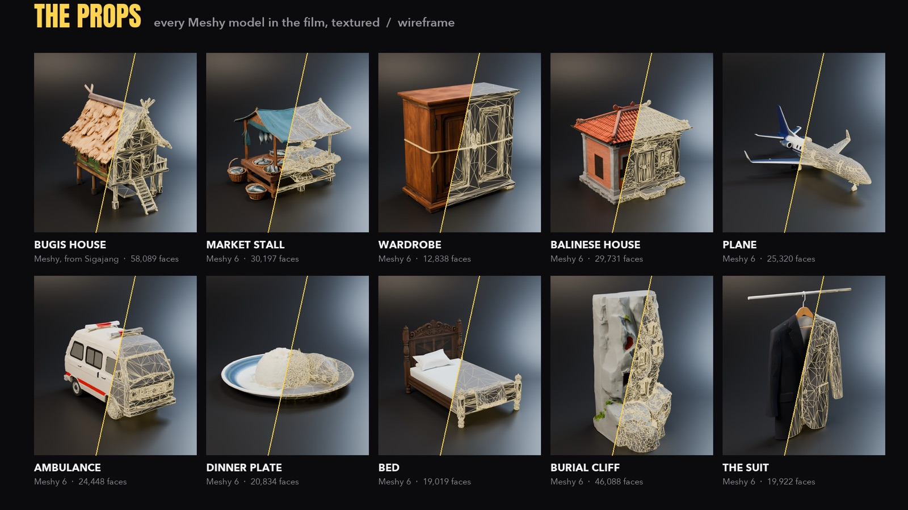

# The props workflow

Tiga Tradisi put 14 Meshy models on screen: four characters and ten props (the Bugis stilt house reused from Sigajang, a market
stall, a wardrobe, a Balinese house, a plane, an ambulance, the dinner plate, a bed, the burial cliff, the ma'nene suit). Two more
were generated and did not make it (the tongkonan and the candi bentar got their culture wrong and were rebuilt by hand).
This is the order that got there, with what each step is for.



| # | step | tool | the user sees |
|---|---|---|---|
| 1 | list | `assets/props.json`: one row per prop the story needs, with its size in studs and a route | the list |
| 2 | block | `blender/prep_props.py` -> stand-in boxes of the right size; shots use `asset(name, ...)` from day one | stills with boxes |
| 3 | plan | `scripts/props_plan.py` -> route, full prompt, calls, credits per prop and the total | the plan + the price |
| 4 | generate | Meshy MCP, one prop at a time, after the user's yes | each image (image route) |
| 5 | ledger | `scripts/ledger.py add <name> <task> <kind> <credits>` the moment a task SUCCEEDS | - |
| 6 | pack | `blender/prep_props.py` again: the boxes become the models, the shots do not change | stills with models |
| 7 | check | each prop in `blender/studio.py` next to a real photo; wrong ones become `kit` | the studio renders |
| 8 | show | `scripts/props_card.py` (THE PROPS), `scripts/pairs.py` (In Meshy / In your work) | the cards |

## 1. The list (assets/props.json)
```json
{
 "plate": {"route": "text", "size": [2, 2, 0.25], "prompt": "Enamel plate of white rice, a small piece of braised fish, chipped blue rim",
           "glb": "assets/raw/plate.glb", "title": "Dinner plate", "source": "Meshy 6", "film": "out/stills/20_0040.jpg"},
 "ambulance": {"route": "text", "size": [4, 8, 5.4], "yaw": 90, "metal": true, "prompt": "Small Indonesian ambulance minivan, off-white, plain red stripe, roof light bar, no emblem"},
 "rumah": {"route": "reuse", "glb": "assets/raw/rumah.glb", "source": "Meshy, from Sigajang"},
 "rumah_top": {"route": "reuse", "glb": "assets/raw/rumah.glb", "cut": 0.262, "card": false},
 "tongkonan": {"route": "image", "size": [7, 16, 14], "prompt": "Toraja tongkonan on timber posts, saddle roof rising at both ends, ..."},
 "candi": {"route": "kit"}
}
```
| key | for |
|---|---|
| `route` | `text` 30, `draft` 15, `image` 33, `multi` 30, `reuse` 0, `kit` 0 credits (below) |
| `size` | studs in the film (a figure is 5.2 tall, a child 3.8, a door 7). Also the stand-in box. In a shot, `asset('plate', loc, yaw, ('x', 1.9))` scales by one axis |
| `prompt` | what it is, in plain words with real names. The plan adds the prefix: *Realistic miniature film prop, worn natural materials, clean silhouette, single object, no people, no text, no logo, no base, plain background.* |
| `yaw`, `cut`, `metal` | turn its front to -Y; slice off the bottom (a carried house without stilts); keep chrome (vehicles only: Meshy bakes metal into wood and cloth) |
| `blend` + `object` | a ready object from a .blend (Sigajang's palms) instead of a GLB |
| `title`, `source`, `card` | the props card: its name, the line under it ("Meshy 6", "Meshy, from Sigajang"), false to leave it off |
| `film` (+ `pair_box`) | the frame of the film where it plays, for the pairs |

**Which props deserve Meshy?** The ones the story touches or the camera holds on: the stake object (Tiga's plate is in six
shots), anything a character carries, a building a scene happens at, a vehicle. Walls, floors, lamps, bowls in the background,
steam, beads and kerupuk were built in Blender (cine_kit boxes) in minutes, for free, and match the light better.

## 2-3. Block, then plan and ask
Block the shots on stand-ins first: sizes and positions are settled before a credit is spent, and a prop that never reads on
screen is dropped from the list for free. Then `python3 -I $SKILL/scripts/props_plan.py $P` and show the user its output: every
prop still to make, its route, the full prompt, and the total. `meshy_check_balance` first. Wait for a yes; it covers that list.

## 4. The routes
| route | Meshy MCP calls | when |
|---|---|---|
| `text` | `meshy_text_to_3d {ai_model: "meshy-6", prompt, target_formats: ["glb"]}` -> `meshy_get_task_status` -> `meshy_text_to_3d_refine {preview_task_id}` -> status -> `meshy_download_model {format: "glb", save_to: "<P>/assets/raw/<name>.glb"}` | everyday objects: Tiga's stall, wardrobe, plate, bed, ambulance, plane, suit, cliff, Balinese house |
| `draft` | the same with `ai_model: "meshy-6-lite"` | background props, many of them, softer detail |
| `image` | `meshy_text_to_image {ai_model: "nano-banana"}` -> show it, wait for OK -> `meshy_image_to_3d {input_task_id, ai_model: "meshy-7.1", texture_model: "meshy-7"}` | it must look like ONE specific thing (a badik, a tongkonan, a pinisi). Text alone drifts: "badik" came back a bowie knife, "pinisi" a galleon |
| `multi` | render 2-4 orthographic views (front first) -> `meshy_multi_image_to_3d {file_paths, ai_model: "meshy-7.1", texture_model: "meshy-7"}` | copy a model you already have; reproduced Sigajang's props almost exactly |
| `reuse` | copy the GLB in, set `source` | a Meshy model from an earlier film (Tiga reused Sigajang's stilt houses) |
| `kit` | a helper in `film/world.py` | Meshy got it wrong, or it must stay under your control (Kakek's coffin) |

A preview (`text`) can be looked at before the 10-credit refine: if the shape is wrong, stop there and rewrite the prompt.
Never re-create a task that timed out before checking `meshy_list_tasks` for it (`references/meshy.md`).

## 6-7. Pack and check
`prep_props.py` joins each GLB, moves its origin to the bottom centre, turns it by `yaw`, cuts it, strips metal, and records its
size; re-render the same stills and the boxes are now models. Then look at every prop in `blender/studio.py` (textured + gold
wireframe, three-quarter view) next to a photo of the real thing. Culture-specific architecture is where Meshy fails most:
the tongkonan came back a gabled barn without the saddle roof, the candi bentar with a lintel a split gate never has. Those became
`kit` (built by hand) and the ledger says why (`ledger.py <P> set tongkonan used no "no saddle roof"`).

## 8. Show the work
- `blender/studio.py <P>` (square, textured + wireframe, face counts) -> `scripts/props_card.py <P>` -> `out/gallery/props_N.jpg`:
  ten props a page, the gold diagonal between the textured model and its wireframe, name, source and face count.
- `WIDE=1 blender/studio.py <P>` -> `scripts/pairs.py <P>` -> `out/gallery/pairs/`: the untouched model next to its film frame.
- Name only the generator that made what is on screen, and keep stand-ins and kit pieces off the Meshy card (the card labels a
  prop with no ledger entry as a stand-in, not as Meshy).
